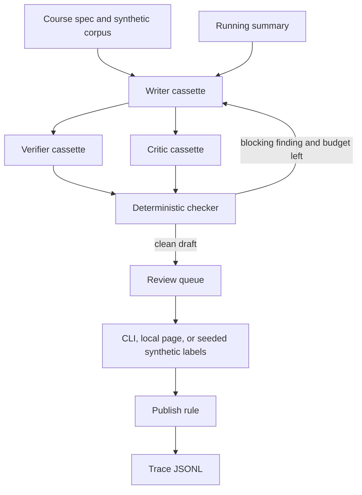

# human-eval-multiagent-pipeline

**100% synthetic; fictional domain.** This repo tests whether a small content pipeline can refuse to publish a lesson that repeats earlier material or states a fact without a citation, and whether a lesson that passes those checks still waits for the required reviews.

Nortia Learning and the course "Foundations of Fictional Logistics" are invented. Nothing here is a client project, a real catalog, or a human calibration study.

## Problem and result

A training team that drafts lessons with a model still has to know what was already said, which sentences are grounded, and who signed off. This pipeline keeps that state in the open: a running summary, a deterministic checker, a versioned rubric, and a trace.

Measured on 2026-10-17, package 0.1.0, commit `d8497e67a8874d56de41ce9d0892e48cdc63f4fd`, Python 3.12.3, pytest 9.1.1, command `python -m pytest`: **21 passed, line coverage 89.99%**. The same tree's happy gate (`python -m hemp eval`) published 4 of 4 lessons after one revision. The forced regression (`python -m hemp eval-regression`) exited 1 and printed `GATE_RED`.

## Demo

```bash
python -m hemp demo
```

`make demo` is the same command. It uses the cassette provider only. It does not call a paid API. Approvals in the demo are synthetic and labeled as such.

## Business case

On the illustrative rate card, the happy course costs **48.041 simulated USD** versus an all-human baseline of **320 simulated USD** for the same 4 lessons (about 272 simulated USD lower). Those rates are **[EST]**. The token counts and the review counts are measured. See [docs/BUSINESS_CASE.md](docs/BUSINESS_CASE.md) and [docs/COST.md](docs/COST.md).

## Architecture



The checker, not the critic cassette, decides whether a draft is clean. The critic can ask for another pass. Publication still needs the rubric's review count. Low critic confidence raises that count from 2 to 3.

## Results

Measured 2026-10-17, package 0.1.0, commit `d8497e6`, commands `python -m hemp eval`, `python -m hemp eval-regression`, and `python -m hemp demo`. Provider `fake-cassette-v1`. No vendor calls.

| Check | Result |
| --- | --- |
| Happy invariants | 16/16 pass (9 safety, 7 quality), `EVAL_PASS` |
| Lessons published on the happy course | 4/4 |
| Writer calls | L1=1, L2=2, L3=1, L4=1 |
| Required raters | L1–L3 = 2; L4 = 3 because critic confidence was 0.55 |
| Repeat cassette | quality fail, safety pass, codes `redundancy`, `repetition`, `objective_gap` |
| Uncited cassette | quality fail, safety pass, codes `uncited_claim`, `uncited_term`, `objective_gap` |
| Regression process exit | 1, stdout contains `GATE_RED` |
| Pytest | 21 passed, coverage 89.99% |

Synthetic agreement on the happy queue (seed 101, 4 items). **Not a human study.**

| Metric | Value | Read it as |
| --- | --- | --- |
| Cohen kappa, rater 1 vs rater 2, overall pass/fail | 1.0 | Every synthetic label stayed inside the publish band, so there is only one category |
| Cohen kappa, clarity scores | 0.5 | The seeded clarity shift. This is the number that shows disagreement |
| Cohen kappa, judge vs majority overall | 1.0 | Judge and majority both passed every item |
| Fleiss kappa, the one 3-rater item | 1.0 | n=1, all three passed. Do not treat this as a study |
| Krippendorff alpha, nominal, overall, missing rater allowed | 1.0 | Same single-category overall labels |

Simulated cost for that run, using the [EST] rate card in `fixtures/cost/illustrative_rates.json`:

| Piece | Value | Kind |
| --- | --- | --- |
| Prompt tokens | 2550 | measured from cassette `usage` |
| Completion tokens | 1550 | measured from cassette `usage` |
| AI portion | 0.041 simulated USD | measured tokens times [EST] 0.01 USD / 1k tokens |
| Human reviews | 9 (2+2+2+3) | measured |
| Human minutes | 72 | 9 times [EST] 8 minutes |
| Human portion | 48 simulated USD | 72/60 times [EST] 40 USD/hour |
| Total | 48.041 simulated USD | under the 80 simulated USD cap |
| Per approved lesson | 12.01025 simulated USD | total / 4 |
| All-human baseline | 320 simulated USD | 4 lessons times [EST] 120 minutes times [EST] 40 USD/hour |

Local cassette latency, same commit, 21 sequential in-process calls of the happy case, nearest-rank on the sorted sample: **p50 2.404 ms, p95 2.65 ms**. That is checker-and-cassette time on this machine, not a model round trip.

## Use cases, governance and business strategy

### 1. Use cases

Client-style. The company is fictional. The pattern is "someone must review training content before it is published."

| Use case | Status | Problem | Who approves | Gated effects | How this repo handles it |
| --- | --- | --- | --- | --- | --- |
| Training-content generation with human review | Implemented | Lessons repeat earlier topics or assert facts with no citation, and a draft can ship with no signer | Nortia content owner. The demo fills that role with synthetic raters. A person can record a label with `hemp review decide` or the local page | Publish, which only writes a local decision. No external post | Running summary, citation check, revision cap, rubric `1.0.0`, review count, trace |
| Policy or handbook drafting | Design only | A policy page can contradict an older page and still look fluent | Named policy owner, outside this repo | Publish to a handbook system | Not built. The same gate shape would apply; there is no policy corpus and no handbook adapter |
| Product-documentation refresh | Design only | A refresh overwrites a current page without showing what changed | Product writer plus a reviewer | Merge into a docs site | Not built. No diff against a live doc tree |

Personal.

| Use case | Status | Problem | Who approves | Gated effects | How this repo handles it |
| --- | --- | --- | --- | --- | --- |
| Study-guide generator with self-review | Design only | Notes drift away from the source you meant to learn | You, on your own machine | Save a guide into your notes | Not built. Would be a single rater and a personal corpus |
| Newsletter drafting with approval | Design only | A draft goes out because the model sounded finished | You, before send | Send the newsletter | Not built. This repo never sends mail |

Design-only versus implemented:

| Capability | Status |
| --- | --- |
| Outline, then lesson drafts that see a running summary | Implemented |
| Writer, verifier, critic, bounded revision loop, stop when the checker is clean and the critic is not asking for another pass | Implemented |
| Cassette and in-memory providers; OpenAI-compatible adapter behind env, off by default, not used in CI | Implemented |
| Rubric as code: citations, grounding, redundancy, repetition, prerequisites, objective coverage, safety phrases | Implemented |
| Review queue as files, CLI, and a local page on 127.0.0.1 | Implemented |
| Several raters per item, Cohen, Fleiss, Krippendorff, judge-versus-majority | Implemented on synthetic labels |
| Adaptive review count when critic confidence is under 0.7 | Implemented |
| Drift report on a simulated weekly series | Implemented |
| Trace JSONL with rubric version, revisions, and the publish decision | Implemented |
| Forced regression that must go red | Implemented |
| Real vector-database retrieval | Design only |
| Managed-platform agent adapters | Design only |
| A rater UI that real people would use in production | Design only. The local page is a file editor, not that product |
| A real inter-rater calibration study | Design only. Do not cite the kappas above as one |

### 2. Governance checklist

| Control | Where it lives |
| --- | --- |
| What may be published, and the rubric version | `rubrics/rubric-v1.json`, `src/hemp/review/queue.py` (`decide`) |
| Human approval, including the synthetic stand-in | `src/hemp/cli.py` (`review decide`), `src/hemp/review/server.py`, `src/hemp/review/synthetic_raters.py` |
| Nothing external is called on the default path | `src/hemp/providers/cassette.py`, `src/hemp/evalkit/invariants.py` (`no_unapproved_external_action`) |
| Traceability | `src/hemp/trace.py`, demo artifact `trace.jsonl` |
| Risks | [docs/RISKS.md](docs/RISKS.md) |
| Costs | [docs/COST.md](docs/COST.md) |
| Incident and rollback | [docs/RUNBOOK.md](docs/RUNBOOK.md) |
| Secret scan in CI | `src/hemp/secretscan.py`, `.github/workflows/ci.yml` |
| Eval gate, including a forced red | `src/hemp/evalkit/`, `make eval`, `make eval-regression` |

Not covered yet:

- A production identity provider, or SSO for reviewers
- Retention and deletion of real learner data (there is none here)
- Legal review of published claims against a real statute
- A signed audit export for a customer
- Load, abuse, or prompt-injection testing against a live model
- Making this repository public

### 3. Business strategy

The business problem is narrow: a training organisation wants model-assisted lessons without losing the record of what a person reviewed. The ROI model is the table in [docs/BUSINESS_CASE.md](docs/BUSINESS_CASE.md): illustrative rates, measured token and review counts, no claim that a real team saved that money. Scope and phases are in [docs/SCOPE.md](docs/SCOPE.md). The numbers this repo can actually move are in [docs/METRICS.md](docs/METRICS.md).

Deployment Strategist conversation: start with discovery, not a model choice. Who is allowed to publish, what must be cited, and what "wrong" costs the reader. Run the pipeline in shadow (drafts and traces, nothing published) until the checker and the reviewers agree on what to block. Only then turn on the gate. The content owner owns the rubric and the publish decision. The person running the system owns the cassette or model adapter, the cost cap, and the rollback. This repository is the shadow-and-gate sketch for a fictional logistics course, not a rollout plan for a real company.

## Decisions

- [0001 Cassette providers and invariant gates](docs/adr/0001-cassette-and-invariant-gates.md)
- [0002 No publish without the required reviews](docs/adr/0002-human-approval-before-publish.md)
- [0003 Standard-library runtime](docs/adr/0003-stdlib-runtime.md)
- [0004 Synthetic labels are not a calibration study](docs/adr/0004-synthetic-raters-are-not-a-study.md)
- [0005 The running summary is explicit state](docs/adr/0005-running-summary.md)

## Security and known limits

What this does **not** do:

- It does not call a model vendor unless you construct the optional adapter and set `HEMP_ALLOW_NETWORK=1`. CI never does that.
- It does not publish to a website, an LMS, or an inbox. "Published" means the local queue status is `approved`.
- It does not retrieve from a vector database.
- It does not authenticate reviewers. The local page binds to 127.0.0.1 and has no login.
- It does not prove that a real group of raters would agree. The kappas are synthetic.
- It does not know whether a sentence is true in the world. It knows whether the sentence overlaps a fictional corpus card and carries that card's id.
- It does not replace a lawyer, an editor, or a content owner.

Details: [SECURITY.md](SECURITY.md), [docs/RISKS.md](docs/RISKS.md).

## How to reproduce

Cost on the default path: **zero**. No key, no network, no vendor invoice.

```bash
python -m pip install -e ".[dev]"
python -m ruff check src tests && python -m ruff format --check src tests
python -m mypy
python -m pytest
python -m hemp eval
python -m hemp eval-regression   # exit code 1 and the line GATE_RED
python -m hemp demo
python -m hemp.secretscan
```

If `make` is installed, the same steps are `make lint`, `make typecheck`, `make test`, `make eval`, `make eval-regression`, `make demo`, and `make secrets`. `make ci` runs the lint, types, tests, happy gate, secret scan, and the assertion that the regression exits 1.

A pending queue with nothing approved:

```bash
python -m hemp generate --artifact-dir artifacts/generate
python -m hemp review list --queue artifacts/generate/queue.json
python -m hemp review serve --queue artifacts/generate/queue.json --port 8765
```

## Next steps

1. Keep the repo private until the checklist in [docs/IP_AND_PROVENANCE.md](docs/IP_AND_PROVENANCE.md) is signed off.
2. If a real corpus shows up, replace the fixture and re-run the gate before anyone treats a draft as publishable. That is a new engagement, not a config flag.
3. A real rater study, a vector store, and a hosted review UI stay design-only until there is a named owner and a reason to build them.

## Docs

- [How it works (interview walkthrough)](docs/HOW_IT_WORKS.md)
- [Business case](docs/BUSINESS_CASE.md)
- [Discovery questions](docs/DISCOVERY.md)
- [Scope](docs/SCOPE.md)
- [Risks](docs/RISKS.md)
- [Metrics](docs/METRICS.md)
- [Cost](docs/COST.md)
- [Runbook](docs/RUNBOOK.md)
- [Architecture](docs/architecture.md)
- [Adapt to a real client](docs/ADAPT_TO_A_REAL_CLIENT.md)
- [Provenance of the eval kit](docs/PROVENANCE.md)
- [IP checklist](docs/IP_AND_PROVENANCE.md)
