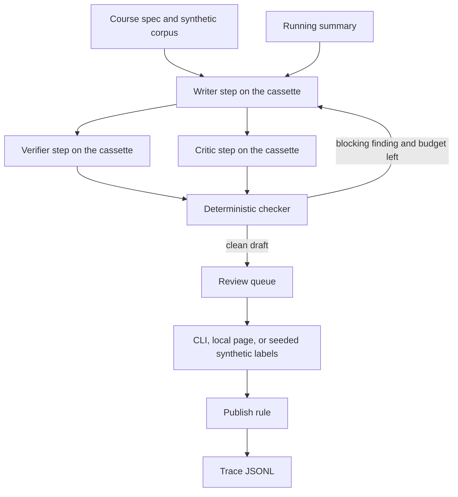

# human-eval-multiagent-pipeline

**Before any publication:** the checklist in [docs/IP_AND_PROVENANCE.md](docs/IP_AND_PROVENANCE.md). This repository stays private until that list is done. The boxes on that checklist are still open. This is a review, not a publication.

**100% synthetic; fictional domain.** A multi-step generation-and-review pipeline for one fictional course. Writer, verifier, and critic are roles replayed from cassettes by default. The repository name says "multiagent"; renaming it is the owner's decision. On the default path those roles are sequential cassette steps. Default mode is deterministic fakes: they test orchestration, the checker, and the gates. Live was run at n=1 and n=3, a small sample, with no rate. judge-vs-human agreement: not measured yet.

Nortia Learning and the course "Foundations of Fictional Logistics" are invented. Nothing here is a client project, a real catalog, or a measurement of human agreement.

## Start here

On the fictional Nortia course, the checker blocks a cassette that repeats an earlier lesson or emits an uncited claim, and a happy cassette reaches `approved` only after the required synthetic reviews (4 of 4 lessons, one revision).
Run `python -m hemp demo` (local code only: no key, no network). `make demo` is the same command.
Walkthrough: [docs/HOW_IT_WORKS.md](docs/HOW_IT_WORKS.md).

## Problem

A training team that drafts lessons with a model still has to know what was already said, which sentences are grounded, and who signed off. The failure that matters here is a lesson that repeats an earlier lesson, or states a fact with no source, and still looks finished. A second failure is a clean draft that ships because nobody was assigned to sign it.

This pipeline keeps that state in the open: a running summary, a deterministic checker, a versioned rubric (`1.0.0`), and a trace. The checker, not the critic step, decides whether a draft is clean. Publication still needs the rubric's review count. Low critic confidence (under 0.7) raises that count from 2 to 3. On the happy course, lesson 4 asked for 3 raters because critic confidence was 0.55.

## Architecture



The default provider is `fake-cassette-v1`. Demo and eval never select the live provider. A live provider exists in code and can replace the cassette outside CI when `LIVE_LLM` is set to 1. Two reviewed runs are in the live-results table below: live was run at n=1 and n=3, a small sample, with no rate. More detail: [docs/architecture.md](docs/architecture.md).

## Quickstart

Cost on the default path: **zero**. No key, no network, no vendor invoice.

```bash
python -m pip install -e ".[dev]"
python -m ruff check src tests && python -m ruff format --check src tests
python -m mypy
python -m pytest --cov=hemp --cov-report=term-missing
python -m hemp eval
python -m hemp eval-regression   # exit code 1 and the line GATE_RED
python -m hemp demo
python -m hemp agreement-demo
python -m hemp.secretscan
make secretscan-hash
python -m hemp review export --n 30
python -m hemp review agreement --file labels/human_labels.template.csv
python -m hemp live --pieces 1   # exit 2 unless LIVE_LLM is 1 and MAX_LIVE_SPEND_USD is set
```

`python -m hemp live` with no live settings exits 2. `make live` is the same command with `--pieces 1`. It is not part of `make ci`. Do not point it at a paid API from CI. Cost per approved piece is not quoted from the two live runs. See [docs/COST.md](docs/COST.md).

If `make` is installed, the same steps are `make lint`, `make typecheck`, `make test`, `make eval`, `make eval-regression`, `make demo`, `make secrets`, and `make secretscan-hash`. `make ci` runs lint, types, tests, the happy gate, the secret scan, the hash check, and the assertion that the regression exits 1.

A pending queue with nothing approved:

```bash
python -m hemp generate --artifact-dir artifacts/generate
python -m hemp review list --queue artifacts/generate/queue.json
python -m hemp review serve --queue artifacts/generate/queue.json --port 8765
```

The local page binds to 127.0.0.1 and has no login.

To import labels later, copy [fixtures/agreement/human_labels_template.csv](fixtures/agreement/human_labels_template.csv) (`item_id,rater_id,label`), fill it outside this repository if the labels are sensitive, and run:

```bash
python -m hemp agreement-import --csv path/to/labels.csv
```

The empty template imports as status `empty` and emits no coefficient. This repository does not ship filled human labels and does not claim a real agreement figure.

Judge versus human, which is a different file from that panel:

```bash
python -m hemp review export --n 30
python -m hemp review agreement --file labels/human_labels.template.csv
```

`review export` writes `labels/human_labels.template.csv` (piece id, claim, source excerpt, empty `human_verdict`, checker `judge_verdict`). On that empty file the agreement command prints `judge-vs-human agreement: not measured yet`. Copy it to `labels/human_labels.csv` (gitignored) and fill `human_verdict` by hand before treating a kappa as a measurement. The 48-item panel is a computation demo of the metric code. It is not this figure.

## Use cases, governance and business strategy

### 1. Use cases

Client-style. The company is fictional. The pattern is "someone must review training content before it is published."

| Use case | Status | Problem | Who approves | Gated effects | How this repo handles it |
| --- | --- | --- | --- | --- | --- |
| Training-content generation with human review | Implemented | Lessons repeat earlier topics or assert facts with no citation, and a draft can ship with no signer | Nortia content owner. The demo fills that role with synthetic raters. A person can record a label with `hemp review decide` or the local page | Publish, which only writes a local decision. No external post | Running summary, citation check, revision cap, rubric `1.0.0`, review count, trace |
| Policy or handbook drafting | Design only | A policy page can contradict an older page and still look fluent | Named policy owner, outside this repo | Publish to a handbook system | Not built. The same gate shape would apply; there is no policy corpus and no handbook adapter |
| Product-documentation refresh | Design only | A refresh overwrites a current page without showing what changed | Product writer plus a reviewer | Merge into a docs site | Not built. No diff against a live doc tree |

Personal.

| Use case | Status | Problem | Who approves | Gated effects | How this repo handles it |
| --- | --- | --- | --- | --- | --- |
| Study-guide generator with self-review | Design only | Notes drift away from the source you meant to learn | You, on your own machine | Save a guide into your notes | Not built. Would be a single rater and a personal corpus |
| Newsletter drafting with approval | Design only | A draft goes out because the model sounded finished | You, before send | Send the newsletter | Not built. This repo never sends mail |

Design-only versus implemented:

| Capability | Status |
| --- | --- |
| Outline, then lesson drafts that see a running summary | Implemented |
| Writer, verifier, and critic steps, bounded revision loop, stop when the checker is clean and the critic step is not asking for another pass | Implemented. Default playback is a cassette |
| Cassette and in-memory providers; optional live chat-completions provider behind env, off by default, not used in CI | Implemented. Two live runs are recorded (n=1 and n=3, a small sample, with no rate) |
| Rubric as code: citations, grounding, redundancy, repetition, prerequisites, objective coverage, safety phrases | Implemented |
| Review queue as files, CLI, and a local page on 127.0.0.1 | Implemented |
| Cohen, Fleiss, Krippendorff, and bootstrap intervals | Implemented as a computation demo on 48 synthetic items. CSV import is implemented. A human study is not. judge-vs-human agreement: not measured yet |
| Adaptive review count when critic confidence is under 0.7 | Implemented |
| Drift report on a simulated weekly series | Implemented |
| Trace JSONL with rubric version, revisions, and the publish decision | Implemented |
| Forced regression that must go red | Implemented |
| Real vector-database retrieval | Design only |
| Managed-platform adapters | Design only |
| A rater UI that real people would use as a product | Design only. The local page is a file editor, not that product |
| A real inter-rater calibration study | Design only. The CSV template is the import path. This repo publishes no real-agreement figure |

### 2. Governance checklist

| Control | Where it lives |
| --- | --- |
| What may be published, and the rubric version | `rubrics/rubric-v1.json`, `src/hemp/review/queue.py` (`decide`) |
| Human approval, including the synthetic stand-in | `src/hemp/cli.py` (`review decide`), `src/hemp/review/server.py`, `src/hemp/review/synthetic_raters.py` |
| Nothing external is called on the default path | `src/hemp/providers/cassette.py`, `src/hemp/evalkit/invariants.py` (`no_unapproved_external_action`) |
| Live provider in code, closed unless configured | `src/hemp/providers/llm_openai_compatible.py`, `src/hemp/providers/step_schema.py`, `src/hemp/config.py` (`load_live_config`). Each step prompt names the step and the JSON schema. Exit 2 without `LIVE_LLM` set to 1 and `MAX_LIVE_SPEND_USD`. Exit 3 (`BUDGET_EXHAUSTED`) when the cap is hit. Prices only from the environment. Two recorded runs: live was run at n=1 and n=3, a small sample, with no rate |
| Traceability | `src/hemp/trace.py`, demo artifact `trace.jsonl` |
| Agreement computation demo, CSV import, and the empty judge-vs-human sheet | `src/hemp/review/agreement_demo.py`, `fixtures/agreement/human_labels_template.csv`, `labels/human_labels.template.csv`. judge-vs-human agreement: not measured yet |
| Risks | [docs/RISKS.md](docs/RISKS.md) |
| Costs | [docs/COST.md](docs/COST.md) |
| Incident and rollback | [docs/RUNBOOK.md](docs/RUNBOOK.md) |
| Secret scan in CI, with a recorded sha256 | `src/hemp/secretscan.py`, `docs/PROVENANCE.md`, `.github/workflows/ci.yml` |
| IP checklist before publication | [docs/IP_AND_PROVENANCE.md](docs/IP_AND_PROVENANCE.md) |
| Eval gate, including a forced red | `src/hemp/evalkit/`, `make eval`, `make eval-regression` |

Not covered yet:

- An identity provider, or SSO for reviewers
- Retention and deletion of real learner data (there is none here)
- Legal review of published claims against a real statute
- A signed audit export for a customer
- A prompt-injection test against a real model. The poisoned-document regression uses a local fake. The live table is two runs, not that test
- A filled human-label file, or any real agreement figure. judge-vs-human agreement: not measured yet
- Making this repository public

### 3. Business strategy

The business problem is narrow: a training organisation wants model-assisted lessons without losing the record of what a person reviewed. The ROI model, with every rate marked [EST], is in [docs/BUSINESS_VALUE.md](docs/BUSINESS_VALUE.md) and [docs/BUSINESS_CASE.md](docs/BUSINESS_CASE.md): illustrative rates, measured token and review counts, no claim that a real team saved that money. Scope and phases are in [docs/SCOPE.md](docs/SCOPE.md). The numbers this repo can actually move are in [docs/METRICS.md](docs/METRICS.md).

Start with discovery, not a model choice. Who is allowed to publish, what must be cited, and what "wrong" costs the reader. Run the pipeline in shadow (drafts and traces, nothing published) until the checker and the reviewers agree on what to block. Only then turn on the gate. The content owner owns the rubric and the publish decision. The person running the system owns the cassette or the optional live provider, the spend cap, and the rollback. This repository is the shadow-and-gate sketch for a fictional logistics course, not a rollout plan for a real company. The repository stays private until the checklist in [docs/IP_AND_PROVENANCE.md](docs/IP_AND_PROVENANCE.md) is done.

## Business value

On the illustrative rate card, the happy course costs **48.041 simulated USD** versus an all-human baseline of **320 simulated USD** for the same 4 lessons (271.959 simulated USD lower on these rates). Those rates are **[EST]**. The token counts and the review counts are measured. The gap is not a saving observed in a team.

The full buyer, levers, KPI table, ROI formula, cost table, measurement plan, and the MEASURED-versus-not split are in [docs/BUSINESS_VALUE.md](docs/BUSINESS_VALUE.md). The rate card itself is [docs/COST.md](docs/COST.md) and [docs/BUSINESS_CASE.md](docs/BUSINESS_CASE.md).

## Proof

### Tests, MEASURED 2026-10-22

**MEASURED** 2026-10-22. Package 0.1.3. Python **3.12.3**. pytest **9.1.1**. Code revision `228dd93981cc1805d627d7b6f1248caa999618de` (this docs change does not change the package). Command:

`python -m pytest --cov=hemp --cov-report=term-missing --cov-report=json:coverage.json`

The project config also passes `--cov-fail-under=80`. Result: **67 passed**, line coverage **89.06%**. pytest-cov printed `CoverageWarning: Module hemp was previously imported, but not measured`. The 89.06% figure is the total pytest-cov printed (`Total coverage: 89.06%`). The same command on 2026-10-17, commit `ccafba8048f54f825c77af89744895f0c7f0c659`, Python 3.12.3, pytest 9.1.1, printed the same 67 passed and 89.06%. CI on GitHub runs Python 3.11. The coverage number above is from Python 3.12.3.

### Cassette results, measured 2026-10-17

These rows were not re-run for the 2026-10-22 pytest line. They stay attributed to package 0.1.3, commit `ccafba8048f54f825c77af89744895f0c7f0c659`, commands `python -m hemp eval`, `python -m hemp eval-regression`, and `python -m hemp demo`. Provider `fake-cassette-v1` on the happy path. No vendor calls.

| Check | Result |
| --- | --- |
| Happy invariants | 17/17 pass (10 safety, 7 quality), `EVAL_PASS` |
| Lessons published on the happy course | 4/4 |
| Writer calls | L1=1, L2=2, L3=1, L4=1 |
| Required raters | L1–L3 = 2; L4 = 3 because critic confidence was 0.55 |
| Repeat cassette | quality fail, safety pass, codes `redundancy`, `repetition`, `objective_gap` |
| Uncited cassette | quality fail, safety pass, codes `uncited_claim`, `uncited_term`, `objective_gap` |
| Poisoned document | quality fail, safety pass, codes `uncited_claim`, `uncited_term`, `objective_gap`, published 0. A fake that drops citations when the corpus contains `EMBEDDED-INSTRUCTION` |
| Regression process exit | 1, stdout contains `GATE_RED` |
| judge-vs-human agreement | not measured yet |

### Agreement computation demo

Synthetic raters only. The numbers demonstrate the metric code. They are not real human agreement. Command `python -m hemp agreement-demo`. Panel seed `20261017`, bootstrap seed `20261018`, 48 items (gold: 12 fail, 36 pass, rule `index % 4 == 0` → fail). Each rater copies the gold label with the design probability and flips it otherwise. 1000 bootstrap resamples of items; 95% percentile interval uses sorted indexes 25 and 975. Coefficients below are rounded to 6 decimal places from that run, recorded on 2026-10-17. Not re-run on 2026-10-22.

| Rater | Design match rate | Realized match on this seed |
| --- | --- | --- |
| careful | 0.90 | 46/48 |
| moderate | 0.75 | 37/48 |
| noisy | 0.55 | 28/48 |

| Metric | Point | 95% interval |
| --- | --- | --- |
| Cohen, careful vs moderate | 0.383399 | 0.120690 to 0.667984 |
| Cohen, careful vs noisy | 0.083333 | -0.170732 to 0.340659 |
| Cohen, moderate vs noisy | 0.125000 | -0.125000 to 0.394595 |
| Fleiss, three raters | 0.176302 | -0.016334 to 0.356596 |
| Krippendorff, nominal | 0.182022 | -0.029835 to 0.365598 |

The 4-lesson course queue is not an agreement result. Do not cite it as one.

judge-vs-human agreement: not measured yet.

### Live results

Live was run at n=1 and n=3, a small sample, with no rate. These two rows are independent runs on 2026-10-17, outside CI, with `LIVE_LLM` set to 1 and `MAX_LIVE_SPEND_USD` set to 0.15. The model for writer, verifier, and critic was xAI `grok-4.20-0309-non-reasoning`. The provider stays off unless that flag is set, and CI does not set it. Checker acceptance is the result of that run, not a rate. On `--pieces 1` the item stayed pending, nothing was published, and the live result was not claimed. `hemp live` does not approve items. judge-vs-human agreement: not measured yet. A later row belongs in [docs/LIVE_RUN_TEMPLATE.md](docs/LIVE_RUN_TEMPLATE.md) only after you review the local report. `python -m hemp live-summary --dir var/live-evals/<stamp>` renders one page from that gitignored directory.

| date | model | command | n | result | real cost (USD) | repo estimate (USD) |
| --- | --- | --- | --- | --- | --- | --- |
| 2026-10-17 | xAI grok-4.20-0309-non-reasoning | `python -m hemp live --pieces 1` | 1 | exit 0. 7 calls: outline, draft L1, verifier, critic, revise, verifier, critic. Checker accepted 1/1. The item stayed pending. Published 0. Live result not claimed | 0.00785 | 0.00879 |
| 2026-10-17 | xAI grok-4.20-0309-non-reasoning | `python -m hemp live --pieces 3` | 3 | exit 0. 25 calls. Checker accepted 1/3. L2 rejected for `weak_grounding` and `repetition`. L3 rejected for `prerequisite_not_accepted` and `repetition`. 0 parse errors and 0 format retries | 0.03416 | 0.03994 |

The repo estimate prices every prompt token at the input rate, including cached prompt tokens, so it is higher than the real charge on both runs. n=1 and n=3 do not support a pass rate or a cost per approved piece.

Simulated cost for the happy cassette, using the [EST] rate card in `fixtures/cost/illustrative_rates.json`. Token and review counts were measured on 2026-10-17. Dollars are [EST]. Not re-measured on 2026-10-22.

| Piece | Value | Kind |
| --- | --- | --- |
| Prompt tokens | 2550 | measured from cassette `usage` |
| Completion tokens | 1550 | measured from cassette `usage` |
| AI portion | 0.041 simulated USD | measured tokens times [EST] 0.01 USD / 1k tokens |
| Human reviews | 9 (2+2+2+3) | measured |
| Human minutes | 72 | 9 times [EST] 8 minutes |
| Human portion | 48 simulated USD | 72/60 times [EST] 40 USD/hour |
| Total | 48.041 simulated USD | under the 80 simulated USD cap |
| Per approved lesson | 12.01025 simulated USD | total / 4 |
| All-human baseline | 320 simulated USD | 4 lessons times [EST] 120 minutes times [EST] 40 USD/hour |

Local cassette latency, 2026-10-17, 21 sequential in-process calls of the happy case, nearest-rank index `round(p * (n - 1))`: **p50 2.373 ms, p95 2.483 ms**. That is checker-and-cassette time on that machine, not a model round trip. Remeasured on commit `ccafba8048f54f825c77af89744895f0c7f0c659`. Not re-measured on 2026-10-22.

## What this does NOT prove

- It does not prove that people agree. judge-vs-human agreement: not measured yet. The agreement demo uses synthetic raters. The CSV import does not certify who produced a file.
- It does not prove a live pass rate. Live was run at n=1 and n=3, a small sample, with no rate. Cost per approved piece is not quoted from those runs.
- It does not prove that the simulated dollars were saved by a team. The 271.959 simulated USD gap uses [EST] rates.
- It does not prove that several model agents collaborated on the default path. Those roles are cassette steps until `LIVE_LLM` is set to 1 outside CI.
- It does not prove that a sentence is true in the world. It knows whether the sentence overlaps a fictional corpus card and carries that card's id.
- It does not call a model unless `python -m hemp live` is run outside CI with `LIVE_LLM` set to 1, `MAX_LIVE_SPEND_USD` greater than 0, and the base URL, key, and model set. Missing config exits 2 and makes no request. Hitting the spend or token cap exits 3 (`BUDGET_EXHAUSTED`), which is not `GATE_RED`. CI never sets `LIVE_LLM`. Demo and eval ignore it. Prices are not stored in the repo.
- It does not publish to a website, an LMS, or an inbox. "Published" means the local queue status is `approved`.
- It does not retrieve from a vector database.
- It does not authenticate reviewers. The local page binds to 127.0.0.1 and has no login.
- It does not replace a lawyer, an editor, or a content owner.
- It does not clear the repository for the public. The checklist in [docs/IP_AND_PROVENANCE.md](docs/IP_AND_PROVENANCE.md) is still open.

Details: [SECURITY.md](SECURITY.md), [docs/RISKS.md](docs/RISKS.md).

## Decisions

- [0001 Cassette providers and invariant gates](docs/adr/0001-cassette-and-invariant-gates.md)
- [0002 No publish without the required reviews](docs/adr/0002-human-approval-before-publish.md)
- [0003 Standard-library runtime](docs/adr/0003-stdlib-runtime.md)
- [0004 Synthetic labels are not a calibration study](docs/adr/0004-synthetic-raters-are-not-a-study.md)
- [0005 The running summary is explicit state](docs/adr/0005-running-summary.md)
- [0006 Optional live provider stays off](docs/adr/0006-optional-live-provider.md)

## Next steps

1. Keep the repo private until the checklist in [docs/IP_AND_PROVENANCE.md](docs/IP_AND_PROVENANCE.md) is signed off.
2. If a real corpus shows up, replace the fixture and re-run the gate before anyone treats a draft as publishable. That is a new engagement, not a config flag.
3. A real rater study starts from the CSV template, with a protocol the owner writes. A vector store and a hosted review UI stay design-only until there is a named owner and a reason to build them.

## Docs

- [How it works (interview walkthrough)](docs/HOW_IT_WORKS.md)
- [Business value](docs/BUSINESS_VALUE.md)
- [Business case](docs/BUSINESS_CASE.md)
- [Discovery questions](docs/DISCOVERY.md)
- [Scope](docs/SCOPE.md)
- [Risks](docs/RISKS.md)
- [Metrics](docs/METRICS.md)
- [Cost](docs/COST.md)
- [Runbook](docs/RUNBOOK.md)
- [Architecture](docs/architecture.md)
- [Adapt to a real client](docs/ADAPT_TO_A_REAL_CLIENT.md)
- [Provenance](docs/PROVENANCE.md)
- [Live run template](docs/LIVE_RUN_TEMPLATE.md)
- [IP checklist](docs/IP_AND_PROVENANCE.md)
- [Security](SECURITY.md)
- [Changelog](CHANGELOG.md)
