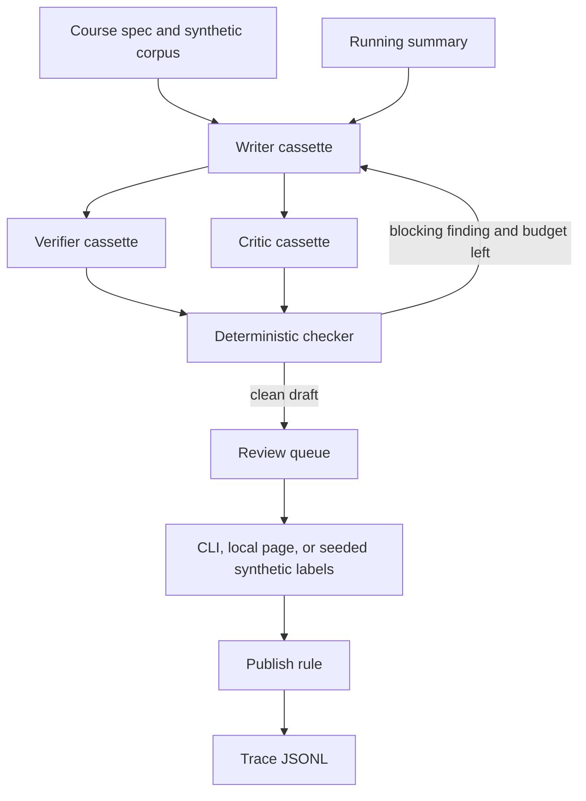

# Architecture

100% synthetic. The runtime has no third-party libraries. Providers, the checker, and the queue are separate so a cassette can be swapped later without rewriting the gate.

## Components

| Piece | Module | Notes |
| --- | --- | --- |
| Course, corpus, rubric, cost card | `src/hemp/load.py` | JSON on disk. Corpus must be labeled `synthetic`. Cost card must be `estimate: true`. |
| Writer / verifier / critic | `src/hemp/providers/cassette.py` | Keyed by `role:step`. A missing key is an error, not a retry. |
| Retries | `src/hemp/providers/retry.py` | Only `TransientProviderError`. Max attempts and a backoff cap. The cassette path does not sleep. |
| Optional network adapter | `src/hemp/providers/openai_compat.py` | Off unless constructed with `allow_network`. Not used by demo or eval. |
| Checker | `src/hemp/checker.py` | Citations, grounding, glossary terms, redundancy, repetition, prerequisite order, clarity length, denylist. |
| Running summary | `src/hemp/models.py` `RunningSummary` | Updated only when a lesson is accepted. |
| Queue and publish rule | `src/hemp/review/queue.py` | Means per dimension, safety on every label, enough labels. |
| Synthetic labels | `src/hemp/review/synthetic_raters.py` | Seeded. Not a sample of people. |
| Agreement | `src/hemp/review/agreement.py` | Cohen, Fleiss, nominal Krippendorff. |
| Sampling | `src/hemp/review/sampling.py` | Confidence under 0.7 selects 3 raters, otherwise 2. |
| Drift | `src/hemp/review/drift.py` | Compares later simulated weeks with the first two. |
| Trace | `src/hemp/trace.py` | JSONL. Every row has `rubric_version`. |
| Gate | `src/hemp/evalkit/` | Re-runs the checker. Does not diff tool traces. |
| Local page | `src/hemp/review/server.py` | `127.0.0.1` only. |

## Effects the pipeline is allowed to record

`queue_human_review` and `write_local_artifact`. Anything else fails `no_unapproved_external_action`. The model output cannot add an effect; the pipeline does not read an effects list from the cassette.

## What is deliberately not in the diagram

A vector store, an identity provider, and a publish adapter. Those are design-only. See the table in the README.
