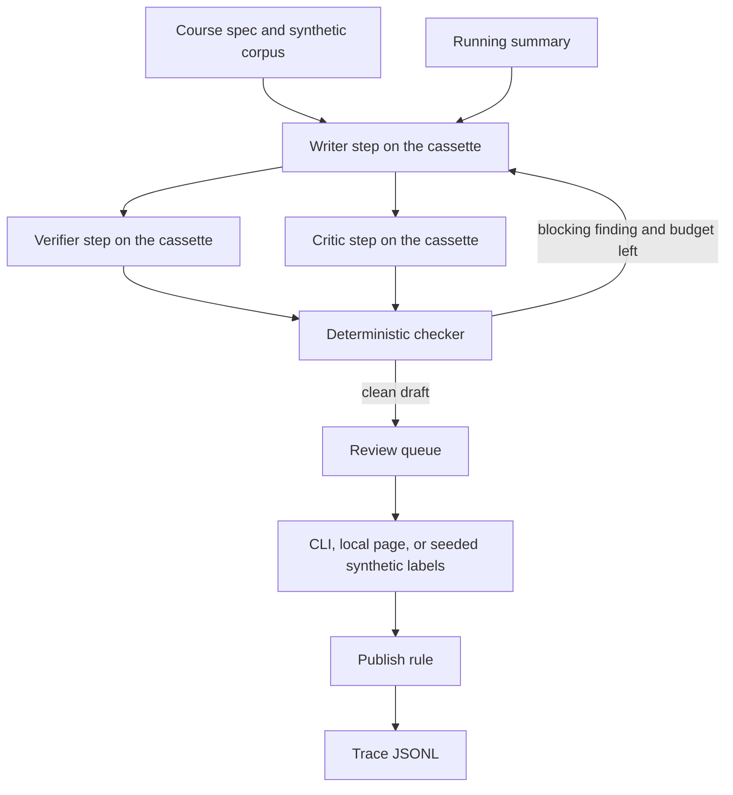

# human-eval-multiagent-pipeline

**Before any publication:** the checklist in [docs/IP_AND_PROVENANCE.md](docs/IP_AND_PROVENANCE.md). This repository stays private until that list is done. The boxes on that checklist are still open. This is a review, not a publication.

**100% synthetic; fictional domain.** A multi-step generation-and-review pipeline for one fictional course. Writer, verifier, and critic are roles replayed from cassettes by default. The repository name says "multiagent"; renaming it is the owner's decision. On the default path those roles are sequential cassette steps. Default mode is deterministic fakes: they test orchestration, the checker, and the gates. Live was run at n=1 and n=3, a small sample, with no rate. judge-vs-human agreement: not measured yet.

Nortia Learning and the course "Foundations of Fictional Logistics" are invented. Nothing here is a client project, a real catalog, or a measurement of human agreement.

## Start here

On the fictional Nortia course, the checker blocks a cassette that repeats an earlier lesson or emits an uncited claim, and a happy cassette reaches `approved` only after the required synthetic reviews (4 of 4 lessons, one revision).
Run `python -m hemp demo` (local code only: no key, no network). `make demo` is the same command.
Walkthrough: [docs/HOW_IT_WORKS.md](docs/HOW_IT_WORKS.md).

## Problem

A training team that drafts lessons with a model still has to know what was already said, which sentences are grounded, and who signed off. The failure that matters here is a lesson that repeats an earlier lesson, or states a fact with no source, and still looks finished. A second failure is a clean draft that ships because nobody was assigned to sign it.

This pipeline keeps that state in the open: a running summary, a deterministic checker, a versioned rubric (`1.0.0`), and a trace. The checker, not the critic step, decides whether a draft is clean. Publication still needs the rubric's review count. Low critic confidence (under 0.7) raises that count from 2 to 3. On the happy course, lesson 4 asked for 3 raters because critic confidence was 0.55.

## Architecture

The default provider is `fake-cassette-v1`. Demo and eval never select the live provider. A live provider exists in code and can replace the cassette outside CI when `LIVE_LLM` is set to 1. Two reviewed runs are in the live-results table below: live was run at n=1 and n=3, a small sample, with no rate. More detail: [docs/architecture.md](docs/architecture.md).

## Quickstart
